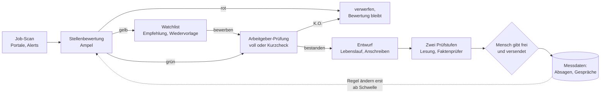

# KI-Assistenzsystem: Struktur statt längerer Prompts

Ein KI-Assistent ist nur so verlässlich wie die Struktur, in der er arbeitet.

Dieses Repo zeigt drei Systeme, die ich für meinen eigenen Alltag gebaut habe und täglich nutze: ein Kontext-Framework für KI-Projekte, ein Agenten-System für die Jobsuche und eine Postfach-Triage, bei der nur der Mensch löscht. Gebaut mit Claude und Claude Code, aber so angelegt, dass sich die Prinzipien auf andere Werkzeuge übertragen lassen.

Kein Framework zum Installieren. Eine Bauanleitung mit echten Beispielen.

---

## 1. Das Problem

Wer mit einem KI-Assistenten ernsthaft arbeitet, trifft auf drei Probleme.

**Er vergisst.** Jede Sitzung beginnt bei null. Regeln, die gestern erklärt wurden, sind heute weg.

**Er erfindet.** Fehlt eine Information, füllt das Modell die Lücke plausibel auf. Eine erfundene Gehaltsspanne sieht genauso überzeugend aus wie eine echte.

**Er driftet.** Steht dieselbe Regel in fünf Prompts, ist sie nach drei Wochen in fünf Varianten vorhanden. Welche gilt?

Die übliche Antwort ist ein längerer Prompt. Meine Antwort ist Struktur: Fakten in Dateien, Regeln an genau einem Ort, Unsicherheit sichtbar gemacht, und der Mensch entscheidet an den Stellen, an denen es zählt.

---

## 2. Das Kontext-Framework

Das Fundament aller drei Systeme ist eine einfache Ordnerkonvention aus Markdown-Dateien.

| Ebene | Inhalt | Beispiel |
|---|---|---|
| L0 | Projektanker: Was ist das hier, welche Dateien sind Wahrheit, welcher Ton gilt | `CLAUDE.md` |
| L1 | Modulregeln je Arbeitsbereich | `job-research/CLAUDE.md` |
| L2 | Datendateien: Fakten, die sich selten ändern | Profil, Kriterien, Zielrollen, Quellen |
| L3 | Prompts: Ziel, Regeln, Output-Vertrag | `prompts/evaluate-job.md` |
| L4 | Arbeitsergebnisse und Status | Bewertungen, Recherchen, Tracker |

Drei Regeln halten das System sauber:

1. **Eine Regel lebt in genau einer Datei.** Die K.O.-Kriterien für eine Stelle stehen in `criteria.md` und nirgends sonst. Jeder Prompt, der sie braucht, verweist darauf. Ändert sich ein Kriterium, ändert sich die Regel an genau einer Stelle. So weit der Plan: Bei der letzten großen Änderung waren trotzdem mehrere Dateien nachzuziehen, weil sich Kopien eingeschlichen hatten.
2. **Prompts enthalten möglichst keine Fakten.** Ein Prompt sagt, was zu tun ist und wie das Ergebnis aussieht. Was wahr ist, steht in den Datendateien. Ausnahmen sind Standardsätze, die wörtlich so rausgehen sollen, und einzelne Rechenregeln.
3. **Jeder Prompt hat einen Output-Vertrag.** Dateiname, Ablageort, Höchstlänge, und welche anderen Dateien danach nachgezogen werden. So entsteht kein Ergebnis, das nur im Chatverlauf existiert.

> **Beispiel: der Output-Vertrag der Stellenbewertung**
>
> - **Datei:** `evaluation-output/2026-09-22_beispielfirma_ai-consultant_eval.md`
> - **Kopf:** maschinenlesbare Felder: Ampel, Empfehlung, je ein Status pro Muss-Kriterium, Gehaltsschätzung mit Quelle, tragende Annahme
> - **Länge:** höchstens 350 Wörter Begründung, bei einer Bewerbungsempfehlung 420 mit Gegenprüfung
> - **Inhalt:** Ampel mit einem Satz Begründung, je eine Zeile pro Muss-Kriterium, Rollen-Match, ATS-Keywords aus der Anzeige, offene Fragen
> - **Danach:** Bei Gelb wandert die Stelle mit Empfehlung und Wiedervorlagedatum auf die Watchlist. Ein Skript baut daraus die Übersicht neu.
>
> Wie ein Pflichtenheft, nur für die Ausgabe der KI. Der nächste Schritt kann sich darauf verlassen: Die Keywords aus dieser Datei fließen in den Entwurf des Lebenslaufs.

Das Framework ist herstellerunabhängig. Es funktioniert mit Claude Code, lässt sich auf Cursor oder Windsurf übertragen und taugt auch als Kontext für API-Aufrufe. Ein Beispiel für den Projektanker liegt in [`beispiele/CLAUDE.beispiel.md`](beispiele/CLAUDE.beispiel.md).

### Vertrag statt Choreografie

Meine ersten Prompts waren Ablaufpläne: Schritt 1, Schritt 2, Phase 3, mit festen Schwellenwerten. Sie wurden lang, widersprachen sich und brachen, sobald eine Stellenanzeige nicht ins Schema passte.

Heute beschreiben die Prompts vor allem drei Dinge: das Ziel, die harten Regeln und den Output-Vertrag. Wo die Reihenfolge zählt, etwa beim täglichen Check, steht ein kurzer Ablauf dabei. Wie das Modell zum Ergebnis kommt, entscheidet es selbst. Ein kleineres Modell führt die Prompts aus, ein größeres prüft die Ergebnisse und entwickelt die Prompts weiter. Jede Korrektur kommt in ein Prüf-Log. Auf Stichproben geht die Prüfung erst, wenn die gemessene Fehlerquote das trägt.

Das muss man pflegen. Im Oktober waren zwei Prompts durch Klarstellungen und Portal-Technik auf rund 1.400 Wörter gewachsen. Ich habe sie halbiert: Formate und Technik stehen jetzt in eigenen Dateien, im Prompt bleiben Ziel, Regeln und Vertrag. Am 20. Oktober lagen 12 von 15 Prompts zwischen 250 und 850 Wörtern, der längste, für das Anschreiben, bei rund 1.100.

---

## 3. Das Agenten-System für die Jobsuche

Die Jobsuche ist ein guter Testfall: viele Daten, harte Kriterien, echte Konsequenzen. Das System führt eine Stelle vom Fund bis zu einer belastbaren Entscheidung: bewerben, klären oder verwerfen.



### Die Bausteine

**Job-Scan.** Durchsucht Portale und E-Mail-Alerts nach definierten Suchbegriffen und legt jede passende Stelle als Volltext-Datei an. Volltext, weil die späteren Schritte die genauen Formulierungen der Anzeige brauchen.

**Stellenbewertung.** Prüft zuerst die Muss-Kriterien. Ein Verstoß beendet die Bewertung. Unklare Punkte werden nicht geraten, sondern als konkrete Frage notiert, die im Anschreiben gestellt wird. Das Gehalt wird nie offen gelassen: Fehlt es in der Anzeige, schätzt das System es mit Quelle, zuerst aus Tarif, dann aus der amtlichen Entgeltstatistik. Das Ergebnis ist eine Ampel mit höchstens 350 Wörtern Begründung (bei einer Bewerbungsempfehlung 420, mit Gegenprüfung) und eine Liste der ATS-Keywords, die später in den Lebenslauf einfließen. Prompt: [`beispiele/prompts/evaluate-job.md`](beispiele/prompts/evaluate-job.md).

**Arbeitgeber-Prüfung.** Pflicht vor jeder Bewerbung. Bei großen Konzernen ohne Krisensignal reicht ein Kurzcheck: Bewertungsportale, Präsenz-Realität, Gehaltsniveau, KI-Reife und eine Presse-Suche. Sonst sieben Dimensionen von Eigentümerstruktur über Finanzen bis Kultur, mit festen Pflichtquellen (Bewertungsportale, Handelsregister, Jahresabschlüsse) und einer aktiven Suche nach Gegenbelegen. Zwei Dateien entstehen: ungekürzte Rohdaten als Beweisgrundlage und ein Bericht, der sich vollständig darauf zurückführen lässt. Prompt: [`beispiele/prompts/employer-check.md`](beispiele/prompts/employer-check.md).

**Recherche und Analyse.** Zwei getrennte Agenten, bewusst. Der Recherche-Agent sammelt Fakten und interpretiert nichts. Der Analyse-Agent zieht Schlüsse, bildet konkurrierende Hypothesen und greift die eigene Hauptaussage im Red Teaming an. Die Trennung verhindert, dass eine Vermutung unterwegs zur Tatsache wird. Prompts: [`recherche.md`](beispiele/prompts/recherche.md), [`analyse.md`](beispiele/prompts/analyse.md).

**Entwurf und Faktencheck der Unterlagen.** Die KI entwirft Lebenslauf und Anschreiben aus einer Master-Datei mit meinen Belegen und schneidet sie auf die Anzeige zu. Danach kommen zwei Prüfstufen: Ein starkes Modell liest Anschreiben, E-Mail und das Profil des Lebenslaufs Satz für Satz, und seit dem 20. Oktober gleicht ein eigener Agent, der den Text nicht geschrieben hat, jede Tatsachenbehauptung gegen die Master-Datei ab. Die Regel dabei: Nichts behaupten, was nicht belegt ist. Was die Anzeige fordert und mir fehlt, landet als Lücke in einer Notiz, damit ich sie im Gespräch ehrlich beantworten kann. Freigeben und versenden tue ich selbst.

### Übergaben über Dateien

Die Agenten sprechen nicht miteinander. Sie lesen und schreiben Dateien. Die Bewertung liest die Stellenanzeige und schreibt einen Bericht. Die Arbeitgeber-Prüfung liest den Bericht. Der Entwurf der Unterlagen liest beides. Der Faktenprüfer liest bewusst kein früheres Urteil, nur die Unterlagen, die Anzeige und die Belege.

Das klingt primitiv und ist der größte Vorteil des Systems. Jede Übergabe ist nachvollziehbar, jedes Zwischenergebnis prüfbar, und ein Fehler lässt sich auf den Schritt zurückverfolgen, in dem er entstanden ist.

### Konfidenz als Pflichtfeld

Jede Zahl, jedes Datum und jede Kernaussage in Recherche und Arbeitgeber-Prüfung trägt eine Kennzeichnung:

| Label | Bedeutung |
|---|---|
| `[H]` | mindestens zwei Primärquellen (Register, Geschäftsbericht, Behörde) |
| `[M]` | eine Primärquelle plus Qualitätsjournalismus, oder zwei gute Sekundärquellen |
| `[N]` | nur Sekundärquellen oder Bewertungsportale |
| `[G]` | nicht belegbar oder widersprüchlich |

Der Analyse-Agent übernimmt diese Labels. Eine `[G]`-Aussage trägt eine Empfehlung höchstens mit ausdrücklichem Vorbehalt. Widersprüche zwischen Quellen werden benannt, nicht geglättet. So sieht man einem Bericht an, wo er stark ist und wo er rät.

---

## 4. Governance: Der Mensch entscheidet

Beide großen Systeme folgen demselben Grundsatz: Die KI bereitet vor, der Mensch entscheidet an den Stellen, die sich nicht rückgängig machen lassen.

### Postfach-Triage

Ein automatisierter Lauf sortiert neue E-Mails nach einem festen Regelwerk in wenige, eindeutige Kategorien: zu erledigen, wartet auf andere, lesen, Referenz, Löschvorschlag. Das Regelwerk (bereinigt) liegt in [`beispiele/gmail-triage.beispiel.md`](beispiele/gmail-triage.beispiel.md).

Die Leitplanken:

- **Die KI löscht nie.** Sie setzt höchstens einen Löschvorschlag. Gelöscht wird von Hand, gesammelt und bewusst.
- **Unsicherheit bekommt einen eigenen Ort.** Liegt die Einschätzung unter etwa 85 %, landet die Mail in „manuell prüfen“ statt in einer geratenen Kategorie.
- **Belege sind geschützt.** Rechnungen und Quittungen werden unabhängig vom Alter nicht zum Löschen vorgeschlagen. Ausnahmen gibt es nur für ausdrücklich benannte Belege ohne steuerlichen Wert.
- **Fehler werden zur Regel.** Korrigiere ich eine falsche Einordnung, markiere ich die Mail. Jeder Lauf beginnt mit diesen Markierungen, leitet ab, welche Regel falsch oder unvollständig war, und meldet das. Die Regel ändere ich dann bewusst im Regelwerk.
- **Der Auftrag ist begrenzt.** Der automatische Lauf bearbeitet nur neue Mails. Der alte Bestand wird nur in gemeinsamen Sitzungen angefasst.

Die Arbeitsteilung dahinter: Das Einsortieren läuft automatisch. Löschen und jede Regeländerung entscheidet der Mensch.

### Jobsuche

- **Die KI versendet nichts.** Sie recherchiert, bewertet, entwirft die Unterlagen und prüft sie. Ob eine Bewerbung rausgeht, entscheide ich: Freigabe, Versand und Konten liegen beim Menschen.
- **Captchas und Logins löst der Mensch.** Die Recherche hält an, meldet die Stelle und macht danach weiter, statt abzubrechen oder sich eine Antwort zusammenzureimen.
- **Nicht belegte Behauptungen sollen raus.** Auch wenn sie gut klingen. Seit dem 20. Oktober prüft das ein eigener Agent, der den Text nicht geschrieben hat. Die Notiz zum Lebenslauf führt jede Lücke offen auf, damit sie im Gespräch vorbereitet werden kann.
- **Versandfertig ist nicht versendet.** Der Tracker unterscheidet beides ausdrücklich. Das kam aus einem echten Fehler: Eine fertige Dankesmail lag gut zwei Wochen ungesendet im System.

---

## 5. Ergebnis

Stand 10. Oktober 2026, nach gut drei Monaten Betrieb:

- **176** Stellenbewertungen
- **41** Stellen auf der Watchlist mit Empfehlung und Wiedervorlagedatum
- **39** Arbeitgeber-Prüfungen, 37 davon mit Rohdaten und Bericht
- **27** Bewerbungen, jede mit eigenem Lebenslauf, 26 mit eigenem Anschreiben

Drei Beispiele, wo die Struktur den Unterschied gemacht hat:

**Die Klärungsmail als Filter.** Unklare Stellen bekommen eine kurze Mail mit zwei Fragen, meist Präsenztage und Gehaltsspanne. Von den an einem Abend versandten Mails kamen am nächsten Tag zwei inhaltliche Antworten, binnen einer Woche zwei weitere. Eine davon machte klar: 100 % Präsenz an einem Ort weit außerhalb meiner Region. Stelle aussortiert, ohne dass ein Lebenslauf geschrieben wurde.

Die Kehrseite habe ich erst später gezählt: Von sechs Rückfragen über ein Karrierenetzwerk wurde keine beantwortet, und jede Klärungsrunde kostete ein bis zwei Wochen. In dieser Zeit sammeln gute Anzeigen ihre ersten hundert Bewerbungen. Heute ist die Bewerbung mit den offenen Fragen im Anschreiben der Standard. Die Klärungsmail bleibt für den Fall, dass ein Nein sehr wahrscheinlich ein Ausschluss wäre und es eine Mailadresse oder Telefonnummer gibt.

**Die Lücke, die keine war.** Beim Abgleich mit einer Anzeige standen zwei Automatisierungswerkzeuge zunächst als „nicht belegt“. Mir fiel auf, dass ich eines davon in einem echten Projekt eingesetzt hatte, es aber nie dokumentiert war. Weil jede Aussage auf die Master-Datei zurückgeht, wurde der Beleg dort nachgetragen und floss danach in alle weiteren Bewerbungen, sauber als Projekterfahrung und nicht als Dauerpraxis.

**Gute Bewertungen, dünne Zahlen.** Ein Arbeitgeber glänzte auf den Bewertungsportalen. Die Pflichtquelle Jahresabschluss zeigte dagegen Verluste und ein negatives Eigenkapital. Kein K.O., aber die Frage nach der Stabilität rückte dadurch ins Erstgespräch. Ohne feste Pflichtquellen wäre nur das freundliche Bild geblieben.

---

## 6. Funktioniert es? Gemessen, nicht behauptet

Eine Demo zeigt, dass ein System läuft. Ob es richtig liegt, zeigt sie nicht. Deshalb hier die Zahlen, auch die unbequemen. Stand 10. Oktober 2026, 173 Stellenbewertungen mit Ampel seit Juli, gezählt nach dem ersten Urteil.

### Die Ampel sagt meistens: unklar

| Ampel | Anzahl | Anteil |
|---|---|---|
| Gelb | 122 | 71 % |
| Rot | 51 | 29 % |
| Grün | 0 | 0 % |

Sieht nach einem schwachen Modell aus. Es ist eine Entscheidung. Grün gab es im ersten Urteil gar nicht. Fünf Stellen wurden später durch einen Nachtrag grün, meist nach einer Klärungsantwort, und auf alle fünf habe ich mich beworben.

Meine wichtigsten Muss-Kriterien sind der Remote-Anteil bei Stellen außerhalb meiner Pendelregion und das Gehalt. Beides steht in kaum einer Anzeige. Ein System, das es trotzdem beantwortet, rät. Lieber Gelb mit einer konkreten Frage als Grün mit einer erfundenen Antwort.

**Die Abwägung:** Eine Klärungsmail zu viel kostet zehn Minuten. Eine verpasste passende Stelle kostet mehr. Also ist Gelb bewusst großzügig.

**Der Preis:** Gelb ist kein Filter mehr, sondern eine Arbeitsliste. Deshalb trägt jede gelbe Stelle eine Empfehlung und ein Wiedervorlagedatum. Von 41 Stellen auf der Watchlist: 20 entscheide ich, 11 geparkt, 8 beobachten, 1 bewerben, 1 pausiert. Stellen, bei denen feststeht, dass ich mich nicht bewerbe, schließe ich inzwischen, statt sie weiter zu beobachten.

### Unbekannt heißt nicht unbelegbar

Gelb wegen fehlender Gehaltsangabe war richtig, solange es keine belastbare Quelle gab. Dann habe ich die amtliche Entgeltstatistik eingebunden: mittlere Bruttogehälter je Beruf und Region aus den Meldungen zur Sozialversicherung, abrufbar über eine öffentliche Schnittstelle. Für meine Zielberufe lag sie fast immer deutlich über dem, was ein großes Gehaltsportal zeigte. Ein Teil davon sind Sonderzahlungen, die die Statistik mitzählt.

Zwei Folgen. Grün ist wieder erreichbar, sobald die Statistik die Untergrenze trägt. Die Bewertung nennt dann Zahl und Quelle und sagt ausdrücklich „geschätzt“. Und meine Gehaltsangabe in Bewerbungen beruht jetzt auf Daten statt auf Gefühl.

### Wenn ich die Empfehlung überstimme

Eine Stelle stand auf Gelb. Im Nachtrag zeigte sich, dass zwei Pflichtanforderungen in meinen Unterlagen nicht belegt waren. Ich habe mich trotzdem beworben. Absage nach vier Tagen, mit einer allgemeinen Begründung.

Ob es genau an diesen zwei Punkten lag, sagt die Absage nicht. Sie passt aber zur Warnung des Systems. Ich habe es überstimmt, und das war in Ordnung, denn die Entscheidung gehört mir. Seitdem nehme ich eine nicht belegte Pflichtanforderung ernster, auch wenn die Anzeige freundlich klingt.

Ändert sich eine Regel, werden die betroffenen Bewertungen neu gerechnet. Die alte Bewertung bleibt als Nachtrag stehen. So sieht man, ob sich das Ergebnis wegen der Stelle geändert hat oder wegen meiner Regel.

### Postfach-Triage: Fehler als Rohstoff

Jede falsche Einordnung markiere ich. Jeder nächtliche Lauf liest diese Markierungen zuerst und meldet, welche Regel versagt hat.

Ausgewertet sind alle Laufprotokolle vom 13. Juli bis 7. Oktober, gezählt hat die KI:

| Messgröße | Wert |
|---|---|
| Neu einsortierte Threads | 1.001 |
| Von mir korrigiert | 4 (0,4 %) |
| Vom System selbst als „manuell prüfen“ markiert | 37 (3,7 %) |
| Vom System selbst als Fehler erkannt und behoben | 3 |

Das Verhältnis ist mir wichtiger als die niedrige Fehlerquote. Das System hat gut neunmal so oft nachgefragt, wie ich es korrigieren musste. Genau so soll es sein.

**Was die Fehler zeigen:** Jede meiner vier Korrekturen führte zu einer Änderung im Regelwerk: Regeln fehlten oder widersprachen sich, einmal war ein Label zwar in Gebrauch, aber nirgends beschrieben. Finden lässt sich so etwas nur an echten Fällen.

**Der Fehler, der mich am meisten gelehrt hat:** Ende September lief der nächtliche Job mit einer veralteten Fassung seines Regelwerks. Das widerspricht meinem eigenen Grundsatz „eine Regel lebt in genau einer Datei“. Der geplante Job liest aber keine Dateien. Er braucht eine Kopie, und die war nicht nachgezogen. Aufgefallen ist es bei einem manuellen Lauf, in dem das System drei eigene Fehlgriffe fand und die Ursache benannte. Inzwischen liest der Job sein Regelwerk direkt aus einer Datei im Projekt, die eingefügte Kopie gibt es nicht mehr. Ganz erfüllt ist der Grundsatz trotzdem nicht: Die ausführbare Regeldatei ist eine Abschrift der Prozessbeschreibung und muss von Hand nachgezogen werden. Außerdem nennt jeder Lauf am Ende den Regelstand, mit dem er gearbeitet hat, und schreibt seine Zählung in eine Logdatei. Auch das hängt an Handarbeit: Nach einer Regeländerung Mitte Oktober blieb das Datum stehen, weil ich es nicht mitgezogen hatte.

**Was sonst schiefging:** Die ersten drei Korrekturen wurden zusammen 25-mal gemeldet, Lauf für Lauf. Die Markierung blieb wochenlang stehen, weil niemand den Fall abgeschlossen hat. Ein Lernsignal braucht einen Endpunkt, sonst wird es zu Rauschen. Außerdem wurde die Markierung einmal für eine Umstellung von 28 Threads benutzt, die gar keine Fehler waren. Ein Messinstrument, das man für etwas anderes benutzt, misst danach nichts mehr.

**Was die Zahl nicht sagt:** Sie zählt nur Fehler, die mir aufgefallen sind. Die Zahl der Threads stammt aus den Gesamtangaben der Läufe; bei sechs Läufen ergeben die Einzelaufstellungen zusammen rund fünf Threads mehr. Außerdem fehlen Protokolle für fünf Tage im September. In diese Lücke fällt vermutlich ein größerer Schwung von 13 Korrekturen, aus denen in einer Sitzung 10 Regeländerungen wurden. Er steht hier gesondert, weil mir für diese Tage der Nenner fehlt.

### Was ich bewusst nicht als Erfolg zähle

Einladungen und Absagen messen nicht das System. Ob eine Firma einlädt, hängt an Lebenslauf, Markt und Timing. Das System beantwortet eine engere Frage: Stimmt die Grundlage, auf der ich entscheide? Für den Lebenslauf selbst lief ab Oktober ein Vergleich zweier Varianten. Seit dem 20. Oktober ruht er, weil ich die Varianten nach Zielrolle neu zuschneide. Bis dahin lag die Zahl der Fälle unter der Schwelle, ab der sie etwas aussagt.

### Was ich vor dem Einsatz in einem Team ändern würde

- **Größeres Testset.** Seit Oktober gibt es einen Regressionstest: eingefrorene, bereits entschiedene Stellen, die nach jeder Regeländerung neu bewertet werden. Er hat schon mehrfach gegriffen, etwa als eine Regel „nur wenn“ als „dann“ gelesen wurde. Sechs Fälle (Stand 20. Oktober) sind zu wenig; im Team wären es 30.
- **Nenner ab Tag eins.** Die frühen Zahlen hat die KI nachträglich aus den Dateien gezählt. Eine zweite Zählung im Oktober fand Fehler, etwa zwei grüne Ampeln, die keine waren. Heute schreibt jeder Scan eine Zählzeile (gesichtet, angelegt, verworfen nach Grund, Ertrag je Quelle), jede Bewerbung ein Merkmalsprofil, und jede Hypothese hat Messgröße und Schwelle, bevor gezählt wird. Im Team gehört das von Anfang an dazu.
- **Kosten pro Lauf.** Messe ich bisher nicht. Für ein Team mit 50 Leuten ist das die erste Frage der Geschäftsführung.
- **Datenschutz.** Postfachinhalte laufen über einen externen Dienst. Im Unternehmen heißt das: Auftragsverarbeitungsvertrag, Datenklassen festlegen, und manche Postfächer bleiben draußen.

---

## 7. Learnings

**Struktur schlägt Prompt-Länge.** Die größten Verbesserungen kamen nicht aus besseren Formulierungen, sondern daraus, Regeln an einen Ort zu verschieben und Fakten aus den Prompts herauszunehmen.

**Unsicherheit muss einen Namen haben.** Ein Modell, das „weiß ich nicht“ sagen darf, sagt es auch. Die Konfidenz-Labels und die Kategorie „manuell prüfen“ sind keine Bürokratie, sondern das, was die Ergebnisse vertrauenswürdig macht.

**Die Grenze zwischen KI und Mensch gehört ins Design.** Wo entscheidet der Mensch? Diese Frage beantworte ich, bevor ich einen Workflow baue, nicht danach. Die Antwort ist fast immer dieselbe: bei allem, was nach außen geht oder sich nicht zurückholen lässt.

**Übersichten erzeugen, nicht pflegen.** Dieselbe Liste an zwei Orten driftet, auch bei mir: Eine Stelle stand in der Statusübersicht unter der falschen Empfehlung. Heute bauen zwei kleine Skripte Watchlist, Zähler und Statistik aus den Dateien. Von Hand bleibt nur, was ein Urteil braucht.

**Erst die Schwelle, dann zählen.** Nach einer Reihe von Absagen ist die Versuchung groß, an allem gleichzeitig zu drehen. Jede Vermutung bekommt deshalb vorher eine Messgröße und eine Schwelle. Darunter ist es Rauschen. Jede Bewertung nennt außerdem die Annahme, auf der sie steht, damit eine Absage zeigt, welche Annahme nicht hielt.

**Dateien sind die beste Schnittstelle.** Was als Datei vorliegt, lässt sich prüfen, versionieren und von einem anderen Werkzeug weiterverwenden. Was nur im Chat steht, ist morgen weg.

---

## 8. Was ein Fachbereich davon übernehmen kann

Die Jobsuche ist nur der Anwendungsfall. Das Muster passt auf viele Prozesse in Unternehmen: Anfragen vorsortieren, Lieferanten prüfen, Dokumente gegen Regeln abgleichen.

Wer KI in einem Team einführt, kann vier Dinge direkt übernehmen:

1. **Regeln aus den Köpfen in Dateien holen.** Bevor ein Assistent eine Aufgabe übernimmt, muss aufgeschrieben sein, was richtig ist. Das hilft auch den Menschen.
2. **Jede Aufgabe mit einem Output-Vertrag versehen.** Was kommt heraus, wo liegt es, wie lang ist es, wer prüft es.
3. **Unsicherheit sichtbar machen.** Eine eigene Kategorie für unklare Fälle ist wertvoller als eine hohe Automatisierungsquote.
4. **Freigabepunkte festlegen, bevor gebaut wird.** Dann ist Governance kein Bremsklotz, sondern der Grund, warum das Team dem System vertraut.

---

## Inhalt dieses Repos

```
README.md                          dieses Dokument
beispiele/
  CLAUDE.beispiel.md               Projektanker des Kontext-Frameworks
  criteria.beispiel.md             Muss- und Soll-Kriterien als Vorlage
  gmail-triage.beispiel.md         Regelwerk der Postfach-Triage
  prompts/
    evaluate-job.md                Stellenbewertung mit Ampel
    employer-check.md              Arbeitgeber-Prüfung
    recherche.md                   strukturierte Recherche mit Konfidenz
    analyse.md                     Hypothesen, Red Teaming, Synthese
```

Die Beispiele sind aus dem laufenden System übernommen und von persönlichen Daten bereinigt: keine Namen, Firmen, Kontakte oder Beträge. Platzhalter stehen in eckigen Klammern. Sie zeigen den Stand vom 10. Oktober 2026; einzelne Regeln haben sich seitdem geändert.

---

**Oliver Klimek** · Hamburg · E-Commerce, Prozessautomatisierung, KI-Integration

Lizenz: [CC BY 4.0](LICENSE). Nutzen und Anpassen erlaubt, mit Namensnennung „Oliver Klimek“ und Link auf dieses Repo.
[linkedin.com/in/0l1v3r](https://www.linkedin.com/in/0l1v3r)
